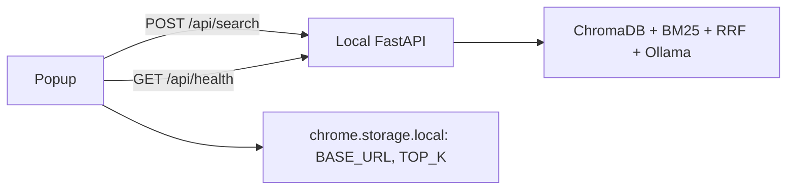

# ApexShot

A Chrome extension (Manifest V3) that acts as a thin client for searching page snapshots.
All search work is done by a **local FastAPI application** (hybrid search:
ChromaDB + BM25 + RRF, embeddings via Ollama bge-m3) — the extension only
sends the query and renders the results.

## Description

Clicking the icon opens a popup with a search field. The query is sent to the
local FastAPI as `POST {BASE_URL}/api/search` with the body `{"query": ..., "top_k": ...}`
(30 s timeout), and the response is rendered as a list of rows: title, score,
matched fields, snippet and a link to the source. If Ollama is unavailable,
the server responds with `degraded: true`, and a notice about full-text mode
appears above the results.

## Installation

1. Clone the repository: `git clone <url>` (or extract the archive)
2. Open `chrome://extensions`
3. Enable "Developer mode"
4. Click "Load unpacked" and select the project folder
5. Click the ApexShot icon — the search popup will open

## Project structure

| File | Purpose |
|------|---------|
| `manifest.json` | MV3: `action` with popup, service worker, `permissions: ["storage"]`, host permissions for localhost |
| `src/popup/popup.html` | Search UI in the popup |
| `src/popup/popup.js` | Logic: health check, `POST /api/search`, result rendering |
| `src/popup/popup.css` | Popup styles |
| `src/options/options.html` | Settings: BASE_URL, TOP_K, connection check |
| `src/options/options.js` | Settings page logic |
| `src/background/service_worker.js` | Minimal service worker: default settings on install |

No build step is required: the extension is plain JavaScript (ES2020+) with no npm
dependencies and is loaded as an unpacked directory.

## Settings

Open them with the gear icon in the popup or via "Extensions → ApexShot → Options".

| Setting | Purpose | Default |
|---------|---------|---------|
| **BASE_URL** | Address of the local FastAPI, e.g. `http://localhost:8080` | `http://localhost:8080` |
| **TOP_K** | How many results to request (1–50) | `10` |

The **"Test connection"** button calls `GET {BASE_URL}/api/health` and shows
"✓ Connected (N snapshots, Ollama: yes/no)" or "✗ Not connected".

## Behavior when the server is unavailable

When the popup opens, it performs a silent `GET /api/health` (8 s timeout —
allowance for Chrome's cold network start; a closed port fails immediately). If
the app is not running, a "Start the local app" banner is shown — the input
stays active, and "Search" gives a clear message instead of failing silently.

## Server

The extension works with a local FastAPI app:

| Method | Endpoint | Purpose |
|--------|----------|---------|
| `GET` | `/api/health` | Status: number of snapshots, Ollama availability |
| `POST` | `/api/search` | Search: `{"query": "...", "top_k": 10}` → list of results (`title`, `score`, `matched_fields`, `snippet`, `source_url`, `degraded` flag) |

Start the local app with:

```bash
uvicorn main:app --reload --port 8080
```

The port is configured with the uvicorn flag; if it differs from `8080`, just
change BASE_URL in the extension settings. No remote search server is used.

## Permissions

| Permission | Purpose |
|------------|---------|
| `storage` | Store BASE_URL and TOP_K in `chrome.storage.local` |
| `host_permissions: http://localhost/*`, `http://127.0.0.1/*` | Requests to the local FastAPI without CORS issues |

Chrome match patterns do not include the port number, so both local hosts are
listed in full — the extension works with any BASE_URL port.

## Architecture



## Manual testing (Chrome)

| Test | Scenario | Expected result |
|------|----------|-----------------|
| T1 | FastAPI is running, index is not empty; enter "CORS configuration in FastAPI" | Results with score and matched_fields |
| T2 | FastAPI is not running | "Start the local app" banner |
| T3 | Change BASE_URL in options to a different port | Search goes to the new port |
| T4 | Stop Ollama | Results arrive with the degraded flag |
| T5 | "Open source" | source_url opens in a new tab |

## Version

`2.0` — renamed to ApexShot, thin client of the local FastAPI,
search moved from a tab into the popup.
