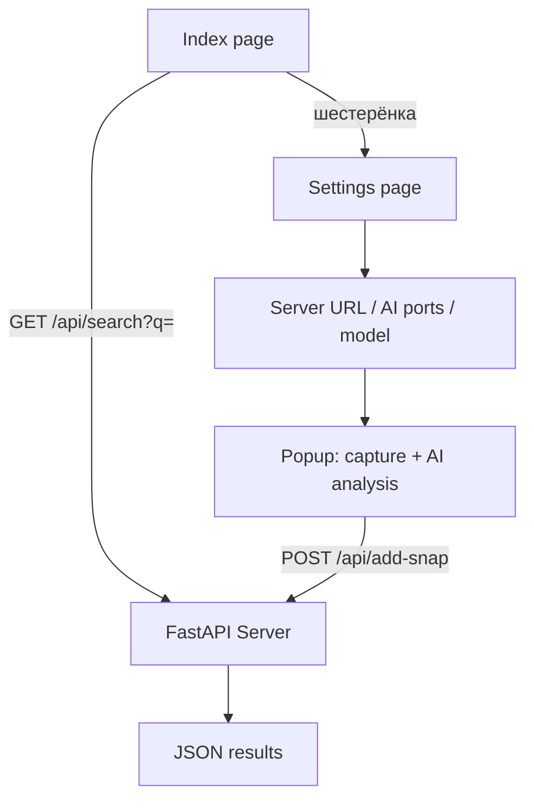

# ApexScan - AI Search

Браузерное расширение (Edge/Chrome, Manifest V3) со своей поисковой страницей. Ищет JSON-слепки на вашем FastAPI-сервере и отправляет на него новые слепки с AI-анализом (Ollama / LM Studio).

## 📋 Описание

ApexScan заменяет стартовую страницу браузера поисковой страницей «Search on ApexScan». Поиск выполняет FastAPI-сервер по адресу, указанному в настройках (**Server URL**). Шестерёнка в правом верхнем углу открывает страницу настроек, кнопка расширения — всплывающее окно со снапшотом страницы.

## 🚀 Установка

1. Откройте `edge://extensions` (или `chrome://extensions`)
2. Включите «Режим разработчика»
3. Нажмите «Загрузить папку расширения» и выберите папку проекта
4. Откройте новую вкладку (Ctrl+T) — откроется поисковая страница ApexScan

## 📁 Структура проекта

| Файл | Назначение |
|------|------------|
| `manifest.json` | Конфигурация Manifest V3, разрешения, content script |
| `index.html` / `index.js` | Поисковая страница (переопределяет новую вкладку) |
| `settings.html` / `settings.js` | Настройки: **Server URL**, AI-сервер, порты, модель |
| `popup.html` / `popup.js` | Окно расширения: снапшот страницы и отправка на сервер |
| `ai-service.js` | Общение с AI-сервером (Ollama / LM Studio), метаданные слепка |
| `content.js` | Сбор данных страницы внутри веб-страницы |
| `background.js` | Service worker: запись Server URL по умолчанию при установке |
| `new_file.html`, `list_files.html` | Страницы из меню «+» |

## 🔧 Как использовать

### Настройки (шестерёнка в правом верхнем углу):
1. **Server URL** — адрес JSON-сервера, например `http://127.0.0.1:8000`
2. Выберите AI-сервер: Ollama или LM Studio, укажите порт и модель (список подтягивается автоматически)
3. Нажмите **Save Settings**

### Поиск:
1. Откройте новую вкладку (Ctrl+T)
2. Введите запрос и нажмите Enter — результаты приходят с сервера в формате JSON

### Снапшот страницы (кнопка расширения):
1. Откройте нужную страницу, нажмите иконку расширения
2. **Generate Snapshot** — захват страницы, AI-анализ, отправка на сервер
3. **Analyze Folder** — анализ списка файлов выбранной папки

## 🌐 Сервер

Расширение обращается к FastAPI-серверу (по умолчанию `http://127.0.0.1:8000`, меняется в настройках):

| Тип | Endpoint |
|-----|----------|
| Поиск | `GET /api/search?q=...` → `{ "total", "limit", "offset", "items": [{ "id", "type", "url", "created_at", "metadata" }] }` |
| Слепок страницы | `POST /api/add-snap` (JSON-тело `{ source_url, thumbnail_base64, metadata_ai }`) |
| Слепок папки | `POST /api/add-folder-snap` (JSON-тело) |

### Запуск сервера:
```bash
cd ../Server_Apex
uvicorn main:app --reload --host 0.0.0.0 --port 8000
```

### Проверка работы:
Откройте `http://127.0.0.1:8000/status` — страница состояния сервера.

## 🔑 Permissions

| Permission | Назначение |
|------------|------------|
| `activeTab` | Доступ к активной вкладке, скриншот для слепка |
| `scripting` | Дозагрузка content-скрипта, если его ещё нет на странице |
| `tabs` | Запрос данных активной вкладки |
| `storage` | Хранение Server URL и конфигурации AI-сервера |
| `host_permissions` (`<all_urls>`) | Запросы к локальному серверу и AI на localhost |

## 🧩 Архитектура



## 📝 Данные слепка

Каждый слепок — обычный JSON:
- `source_url` — URL страницы (или `file:///имя_папки`)
- `thumbnail_base64` — скриншот страницы (JPEG base64)
- `metadata_ai` — AI-метаданные: `tags`, `sentiment`, `summary`, `category`

AI-анализ выполняется через Ollama (`POST /api/generate`) или LM Studio (`POST /v1/chat/completions`) — см. `ai-service.js`.

## 📅 Версия

`1.1` — Поисковая страница вместо popup, настройки в отдельной вкладке, Server URL в настройках

## 📝 Примечания

- Для поиска нужен запущенный FastAPI-сервер с эндпоинтом `GET /api/search?q=`
- Поисковая страница переопределяет новую вкладку (`chrome_url_overrides.newtab`)
- AI-анализ работает, только если запущен Ollama или LM Studio на указанном порту
=======
# APEX-Snap-Edge-Extension
APEX
