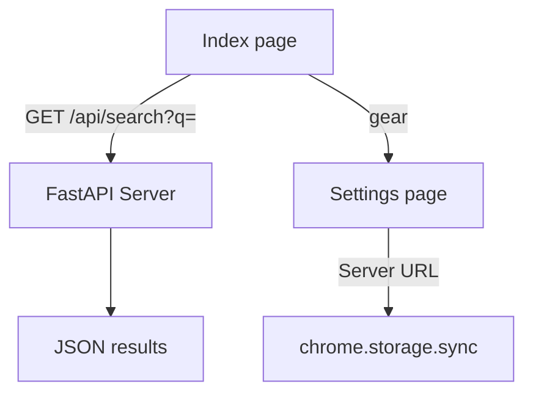

# ApexScan - AI Search

A browser extension (Edge/Chrome, Manifest V3) with its own search page. It searches JSON snapshots on your FastAPI server.

## 📋 Description

The «Search on ApexScan» page opens in a new tab only when the extension icon is clicked. The search is performed by a FastAPI server at the address specified in the settings (**Server URL**). The gear in the top-left corner opens the settings page, and the cross in the top-right closes the search tab.

## 🚀 Installation

1. Open `edge://extensions` (or `chrome://extensions`)
2. Enable «Developer mode»
3. Click «Load unpacked extension» and select the project folder
4. Click the extension icon — the ApexScan search page will open in a new tab

## 📁 Project Structure

| File | Purpose |
|------|---------|
| `manifest.json` | Manifest V3 configuration, permissions, content script |
| `index.html` / `index.js` | Search page (opens in a new tab when the icon is clicked) |
| `viewer.html` / `viewer.js` | Viewing a single snapshot (`GET /api/snaps/{id}`): Summary, Facts, Highlights, Entities, Raw JSON |
| `settings.html` / `settings.js` | Settings: **Server URL** |
| `background.js` | Service worker: saves the default Server URL on install |
| `ai-service.js`, `content.js` | Placeholder files (currently unused) |
| `new_file.html`, `list_files.html` | Placeholder pages (currently unused) |

## 🔧 How to Use

### Settings (gear in the top-left corner):
1. **Server URL** — the address of the JSON server, e.g. `http://127.0.0.1:8000`
2. Click **Save Settings**

### Search:
1. Click the extension icon — the page will open in a new tab
2. Enter a query and press Enter — the list of snapshots arrives from the server in JSON format (title, link, date, tags, confidence)
3. Clicking a card opens the snapshot viewer page (the «← Back to search» button returns to the search)
4. The cross in the top-right corner closes the search tab

## 🌐 Server

The extension talks to a FastAPI server (default `http://127.0.0.1:8000`, changeable in settings):

| Type | Endpoint |
|------|----------|
| Search | `GET /api/search?q=...` → `{ "total", "limit", "offset", "items": [{ "id", "type", "url", "created_at", "snippet" }] }` |
| Snapshot by id | `GET /api/snaps/{snap_id}` → full snapshot JSON (`metadata.apex` for ApexShot snapshots) |

### Running the server:
```bash
cd ../Server_Apex
uvicorn main:app --reload --host 0.0.0.0 --port 8000
```

### Checking that it works:
Open `http://127.0.0.1:8000/status` — the server status page.

## 🔑 Permissions

| Permission | Purpose |
|------------|---------|
| `activeTab` | Access to the active tab |
| `scripting` | Injecting the content script if it is not already on the page |
| `tabs` | Querying data of the active tab |
| `storage` | Storing the Server URL |
| `host_permissions` (`<all_urls>`) | Requests to the local localhost server |

## 🧩 Architecture



## 📅 Version

`1.1` — Search page opens on icon click, settings in a separate tab, Server URL in settings

## 📝 Notes

- Search requires a running FastAPI server with the `GET /api/search?q=` endpoint
