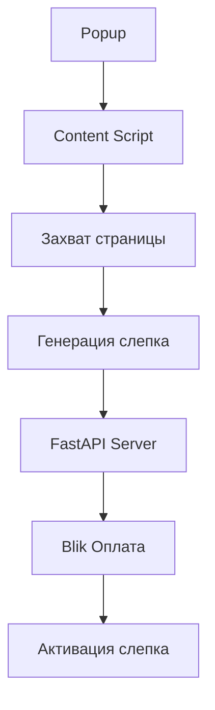

# Binary Snap - AI Indexer

Браузерное расширение для создания бинарных слепков веб-страниц с AI-анализом.

## 📋 Описание

Binary Snap захватывает данные активной страницы, генерирует бинарный слепок с метаданными AI и отправляет их на сервер за 5 PLN через Blik.

## 🚀 Установка

1. Откройте браузер Chrome/Edge
2. Перейдите по адресу `chrome://extensions`
3. Включите "Режим разработчика"
4. Нажмите "Загрузить папку расширения" и выберите директорию `EdgeSnapExtension`

## 📁 Структура проекта

| Файл | Назначение |
|------|------------|
| `manifest.json` | Конфигурация Manifest V3, разрешения и настройки |
| `popup.html` | Интерфейс popup-окна расширения |
| `popup.js` | Логика генерации слепка и отправки на сервер FastAPI |
| `content.js` | Скрипт работы внутри веб-страницы (захват данных) |

## 🔧 Как использовать

### Для веб-страниц:
1. Откройте нужную веб-страницу
2. Нажмите на иконку расширения → появится popup
3. Кликните **"Сгенерировать слепок"** — данные страницы захватываются
4. После сохранения появляется кнопка **"Оплатить Blik (5 PLN)"**
5. Оплата активирует слепок

### Для анализа папки:
1. Нажмите на иконку расширения → появится popup
2. Кликните **"📁 Анализировать папку"**
3. Выберите директорию в файловой системе
4. Слепок сгенерируется для всех файлов в папке

## 🌐 Сервер

Расширение отправляет данные на FastAPI-сервер:

| Тип | Endpoint |
|-----|----------|
| Веб-страница | `http://127.0.0.1:8000/api/add-snap` |
| Локальная папка | `http://127.0.0.1:8000/api/add-folder-snap` |

Перед использованием убедитесь, что сервер запущен и доступен.

### Запуск сервера:
```bash
cd server_project
uvicorn main:app --reload --host 0.0.0.0 --port 8000
```

### Проверка работы:
Откройте `http://127.0.0.1:8000` — должен показать список endpoints.

## 🔑 Permissions

| Permission | Назначение |
|------------|------------|
| `activeTab` | Доступ к активной вкладке для захвата данных |
| `storage` | Сохранение метаданных и конфигурации |

## 🧩 Архитектура



## 📝 Данные слепка

Каждый слепок содержит:
- `source_url` — URL страницы
- `thumbnail_base64` — скриншот страницы
- `binary_data` — бинарный слепок
- `metadata_ai` — AI-метаданные (теги, sentiment и т.д.)

## 🛠 Разработка

Для интеграции с реальным AI-анализом замените симулированные данные в `popup.js`:

```javascript
// Текущие placeholder'ы:
const thumbnailBase64 = "data:image/png;base64,iVBORw0KG5...";
const binaryData = "010010110...";
const metadataAI = { tags: ["news", "politics"], sentiment: 0.8 };
```

## 📅 Версия

`1.0` — Initial release

## 📝 Примечания

- Оплату Blik можно интегрировать с реальным payment gateway
- AI-анализ может быть расширен через внешние API
- Поддерживается Manifest V3 (Chrome/Edge)