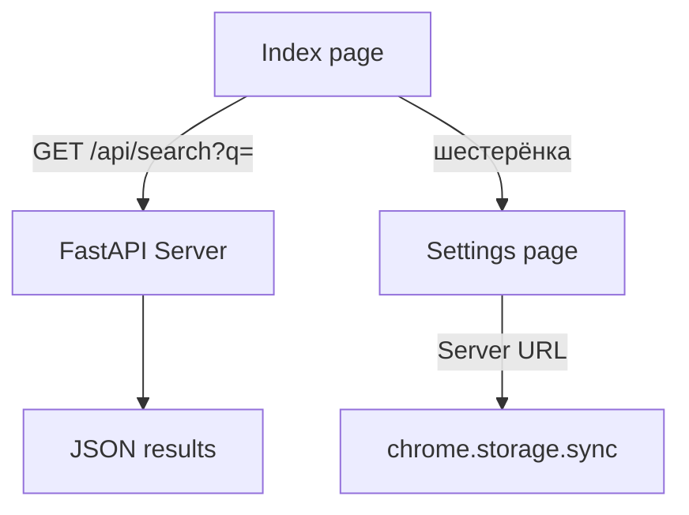

# ApexScan - AI Search

Браузерное расширение (Edge/Chrome, Manifest V3) со своей поисковой страницей. Ищет JSON-слепки на вашем FastAPI-сервере.

## 📋 Описание

Поисковая страница «Search on ApexScan» открывается в новой вкладке только при нажатии на иконку расширения. Поиск выполняет FastAPI-сервер по адресу, указанному в настройках (**Server URL**). Шестерёнка в левом верхнем углу открывает страницу настроек, крестик в правом верхнем — закрывает вкладку поиска.

## 🚀 Установка

1. Откройте `edge://extensions` (или `chrome://extensions`)
2. Включите «Режим разработчика»
3. Нажмите «Загрузить папку расширения» и выберите папку проекта
4. Нажмите иконку расширения — поисковая страница ApexScan откроется в новой вкладке

## 📁 Структура проекта

| Файл | Назначение |
|------|------------|
| `manifest.json` | Конфигурация Manifest V3, разрешения, content script |
| `index.html` / `index.js` | Поисковая страница (открывается в новой вкладке по клику на иконку) |
| `settings.html` / `settings.js` | Настройки: **Server URL** |
| `background.js` | Service worker: запись Server URL по умолчанию при установке |
| `ai-service.js`, `content.js` | Заготовки (сейчас не используются) |
| `new_file.html`, `list_files.html` | Заготовки страниц (сейчас не используются) |

## 🔧 Как использовать

### Настройки (шестерёнка в левом верхнем углу):
1. **Server URL** — адрес JSON-сервера, например `http://127.0.0.1:8000`
2. Нажмите **Save Settings**

### Поиск:
1. Нажмите иконку расширения — страница откроется в новой вкладке
2. Введите запрос и нажмите Enter — результаты придут с сервера в формате JSON
3. Крестик в правом верхнем углу закрывает вкладку поиска

## 🌐 Сервер

Расширение обращается к FastAPI-серверу (по умолчанию `http://127.0.0.1:8000`, меняется в настройках):

| Тип | Endpoint |
|-----|----------|
| Поиск | `GET /api/search?q=...` → `{ "total", "limit", "offset", "items": [{ "id", "type", "url", "created_at", "metadata" }] }` |

### Запуск сервера:
```bash
cd ../Server_Apex
uvicorn main:app --reload --host 0.0.0.0 --port 8000
```

### Проверка работы:
Откройте `http://127.0.0.1:8000/status` — страница состояния сервера.

## 🔑 Permissions

| Permission | Назначение |
|------------|------------|
| `activeTab` | Доступ к активной вкладке |
| `scripting` | Дозагрузка content-скрипта, если его ещё нет на странице |
| `tabs` | Запрос данных активной вкладки |
| `storage` | Хранение Server URL |
| `host_permissions` (`<all_urls>`) | Запросы к локальному серверу на localhost |

## 🧩 Архитектура



## 📅 Версия

`1.1` — Поисковая страница открывается по клику на иконку, настройки в отдельной вкладке, Server URL в настройках

## 📝 Примечания

- Для поиска нужен запущенный FastAPI-сервер с эндпоинтом `GET /api/search?q=`
