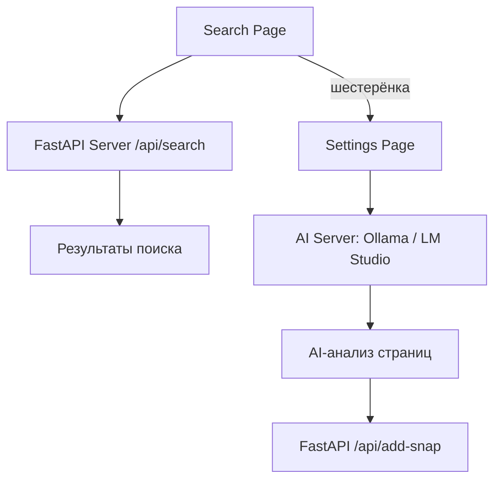

# ApexScan - AI Search

Браузерное расширение с собственной поисковой страницей и AI-анализом веб-страниц.

## 📋 Описание

ApexScan заменяет стартовую страницу браузера поисковой страницей (в стиле Startpage) — «Search on ApexScan». Поиск обрабатывает FastAPI-сервер. Шестерёнка в правом верхнем углу открывает страницу настроек, где настраивается AI-сервер (Ollama / LM Studio) и URL FastAPI.

## 🚀 Установка

1. Откройте браузер Chrome/Edge
2. Перейдите по адресу `chrome://extensions`
3. Включите "Режим разработчика"
4. Нажмите "Загрузить папку расширения" и выберите директорию `EdgeSnapExtension`
5. Откройте новую вкладку (Numpad `0` / Ctrl+T) — откроется поисковая страница ApexScan

## 📁 Структура проекта

| Файл | Назначение |
|------|------------|
| `manifest.json` | Конфигурация Manifest V3, разрешения и настройки |
| `search.html` | Поисковая страница (стартовая страница браузера) |
| `search.js` | Логика поиска: запрос к FastAPI-серверу, вывод результатов |
| `settings.html` | Страница настроек (открывается по шестерёнке) |
| `settings.js` | Логика настроек: AI-сервер (Ollama/LM Studio), порт, модель, URL FastAPI |
| `ai-service.js` | Общение с AI-сервером (Ollama / LM Studio), метаданные слепка |
| `content.js` | Скрипт работы внутри веб-страницы (захват данных) |

## 🔧 Как использовать

### Поиск:
1. Откройте новую вкладку (Ctrl+T) — стартовая страница ApexScan
2. Введите запрос в поле «Search on ApexScan» и нажмите Enter
3. Результаты приходят с FastAPI-сервера

### Настройки (шестерёнка в правом верхнем углу):
1. Откройте страницу настроек — в новой вкладке
2. Укажите URL FastAPI-сервера (например `127.0.0.1:8000`)
3. Выберите AI-сервер: Ollama или LM Studio
4. Настройте порт и модель (список моделей подтягивается автоматически)
5. Нажмите **Save Settings**

## 🌐 Сервер

Расширение отправляет запросы на FastAPI-сервер (по умолчанию `http://127.0.0.1:8000`, меняется в настройках):

| Тип | Endpoint |
|-----|----------|
| Поиск | `POST /api/search` (тело: `{ "query": "..." }`) |

Перед использованием убедитесь, что сервер запущен и доступен.

### Запуск сервера:
```bash
cd server_project
uvicorn main:app --reload --host 0.0.0.0 --port 8000
```

### Проверка работы:
Откройте `http://127.0.0.1:8000` — должен показать список endpoints.

## 🔑 Permissions

| Permission | Назначение |
|------------|------------|
| `activeTab` | Доступ к активной вкладке для захвата данных |
| `scripting` | Вспрыскивание content-скрипта в нужную вкладку |
| `tabs` | Запрос метаданных активной вкладки |
| `storage` | Сохранение метаданных и конфигурации |

## 🧩 Архитектура



## 📝 Данные слепка

Каждый слепок содержит:
- `source_url` — URL страницы
- `thumbnail_base64` — скриншот страницы
- `binary_data` — бинарный слепок
- `metadata_ai` — AI-метаданные (теги, sentiment и т.д.)

AI-анализ (теги, sentiment, категория, summary) формируется через Ollama или LM Studio — см. `ai-service.js`.

## 📅 Версия

`1.1` — Поисковая страница вместо popup, настройки в отдельной вкладке

## 📝 Примечания

- Для поиска нужен запущенный FastAPI-сервер с эндпоинтом `POST /api/search`.
  Ожидаемый формат ответа: `{ "results": [{ "title", "url", "snippet" }] }`
- Поисковая страница переопределяет стартовую страницу браузера (`chrome_url_overrides.startpage`)
- AI-анализ может быть расширен через внешние API